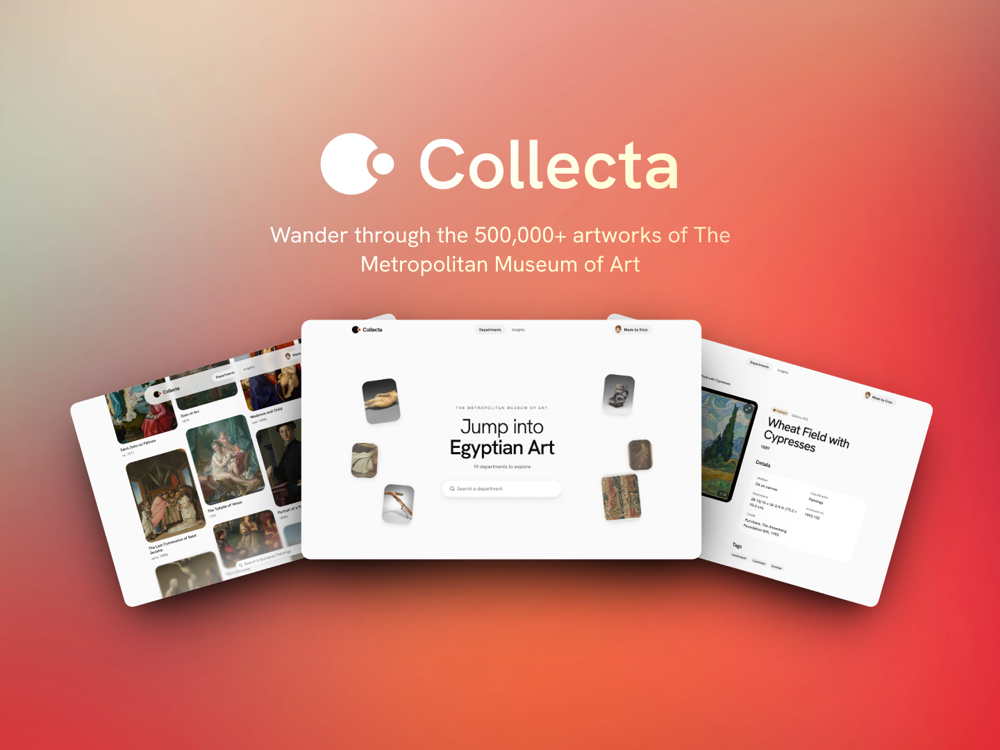

<h1 align="center">
    <br>
        
    <br>
    Collecta
</h1>

<h4 align="center">Wander through the 500,000+ artworks of The Metropolitan Museum of Art 🏛️</h4>

<p align="center">
  <a href="#-roadmap">Roadmap</a> •
  <a href="#%EF%B8%8F-getting-started">Getting started</a> •
  <a href="#%EF%B8%8F-architecture">Architecture</a> •
  <a href="#-blocking-points">Blocking points</a> •
  <a href="#-ai-usage">AI usage</a> •
  <a href="#%EF%B8%8F-technologies">Technologies</a> •
  <a href="#-credits">Credits</a>
</p>



Collecta is a responsive web app built on the [Met Museum Collection API](https://metmuseum.github.io/). It shows all departments, artworks and charts of the museum.

## ✨ Roadmap

- [x] **Department list**: search and list departments
- [x] **Artworks of a department**: masonry grid with parallax, search and filters, "Load more" pagination
- [x] **Artwork detail**: image gallery with a carousel, full-screen with keyboard navigation, facts and tags, map of where the artwork comes from
- [x] **Insights**: key figures, artworks through the ages, weight of each department, and per-department charts
- [x] **Polish**: shared-image view transitions between pages, skeleton screens, automatic dark mode, mobile navbar
- [x] **Tests**: integration tests (Vitest + Testing Library) and end-to-end tests (Playwright), both on a mocked Met API

## 🛠️ Getting started

### Code

To clone and run the app, you need [Git](https://git-scm.com) and [Node.js](https://nodejs.org/en/download/) **22.12 or later** (it comes with [npm](http://npmjs.com), the package manager used by the project). No API key and no `.env` file are needed: the Met API is public. From your terminal:

```bash
# Clone the project
$ git clone https://github.com/HeineZo/Collecta.git

# Move into the project
$ cd Collecta

# Install the dependencies
$ npm install

# Start the app on http://localhost:5173
$ npm run dev
```

### Tests

```bash
# Integration tests (Vitest, jsdom)
$ npm test

# End-to-end tests (Playwright)
$ npm run test:e2e
```

Both suites answer the Met API from local fixtures (`src/test/fakeMetApi.ts`), so they run offline and never hit the API rate limit.

### Other scripts

| Script | What it does |
| --- | --- |
| `npm run build` | Type-checks and builds the app into `dist/` |
| `npm run preview` | Serves the built app |
| `npm run lint` | Lints the code with Oxlint |
| `npm run bones` | Regenerates the skeleton screens (needs `npm run dev` running) |

## 🏗️ Architecture

```
src/
├── api/          # One file per Met API resource, plus the HTTP client and the request queue
├── models/       # One type per file (Artwork, Department, CollectionQuery…)
├── hooks/        # SWR data hooks (useArtwork, useDepartmentArtworks…) and UI hooks (useMagnetic, useScrollEdges…)
├── pages/        # One component per route; pages only compose components
├── components/
│   ├── artwork/      # Artwork card, grid, filters, gallery, lightbox, origin map…
│   ├── department/   # Department list and heroes
│   ├── insights/     # Insights charts
│   ├── layout/       # Navbar, footer, breadcrumbs
│   ├── common/       # Components shared by several pages (search bar, error state, masonry grid…)
│   └── ui/           # Components copied from Aceternity, mapcn and Amicro, adapted to the app
├── router/       # Routes and scroll restoration
├── lib/          # Small pure helpers (formatting, plurals, class names)
├── data/         # Hand-written culture/country → coordinates table for the map
├── bones/        # Skeletons generated by boneyard
└── test/         # Fake Met API and render helpers for the tests
e2e/              # Playwright specs
```

**Routes**

| Route | Page |
| --- | --- |
| `/` | List of the 19 departments |
| `/departments/:departmentId` | Artworks of a department, with `?q=` and filters in the URL |
| `/departments/:departmentId/artworks/:artworkId` | Artwork detail |
| `/insights` | Charts on the whole collection or on one department (`?department=`) |

## 🧱 Blocking points

- **The Met API blocks bursts of requests.** It sits behind a bot protection: after 80 calls it answers `403`. The fix is a queue that allows at most 4 calls at a time (`src/api/requestQueue.ts`), an SWR cache that never refetches what it already has, a single retry, and a "Try again" button. The tests use a fake API so they never trigger it.
- **mapcn did not fit with HeroUI.** It expects a shadcn/ui setup, whose CSS variables clash with HeroUI's. I copied the map component by hand into `src/components/ui/map.tsx` and mapped its colors to the HeroUI theme.
- **Skeleton generation.** boneyard captures skeletons by crawling the running app. SWR is paused during the capture so it makes no API call, and the detail routes are listed in `boneyard.config.json` because the crawler cannot find them.
- **"Load more" made the grid jump.** New artworks reshuffled the columns; a masonry grid that keeps existing cards in place fixed it.

## 🤖 AI usage

I used AI to generated integration tests and end-to-end tests so that I can check that introducing new features doesn't break anything else. I also used it to build the animations of the app: the artworks following the cursor in the hero, the hero that shrinks while scrolling, the parallax and magnetic cards, the chart transitions.

A good part of the animated components does not come from AI but from component libraries, which I browsed to pick the effects:

- [React Bits](https://reactbits.dev): the image trail of the department list hero, and ideas for the micro-animations
- [Aceternity UI](https://ui.aceternity.com/components): the resizable navbar and the zoom lens on artworks
- [Amicro mono charts](https://amicro.vercel.app/mono-charts): the Insights charts

## 🕹️ Technologies


#### Plus
  - [HeroUI](https://heroui.com) for the UI components, [SWR](https://swr.vercel.app) for data fetching and caching, [React Router](https://reactrouter.com) for routing
  - [boneyard](https://boneyard.vercel.app) for the skeleton screens
  - [Motion](https://motion.dev) for the animations, [Scritto](https://scrit.to) for the animated text
  - [Recharts](https://recharts.org) with [Amicro mono charts](https://amicro.vercel.app/mono-charts) for the charts
  - [mapcn](https://mapcn.dev) on [MapLibre](https://maplibre.org) for the map
  - [Lucide](https://lucide.dev) for the icons

## 🤠 Credits

<table>
    <tr>
        <td align="center">
            <a href="mailto:nzomorvan@gmail.com">
                
                <br />
                <sub><b>Enzo</b></sub>
            </a>
            <br />
        </td>
    </tr>
</table>

Data from [The Metropolitan Museum of Art Collection API](https://metmuseum.github.io/).
